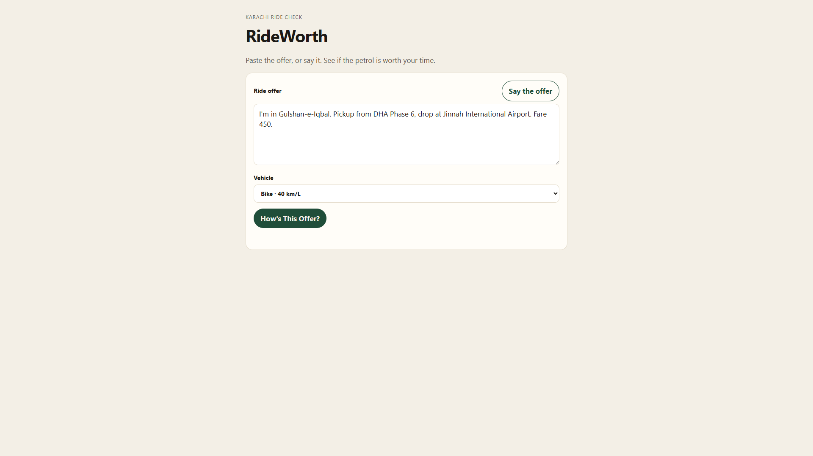
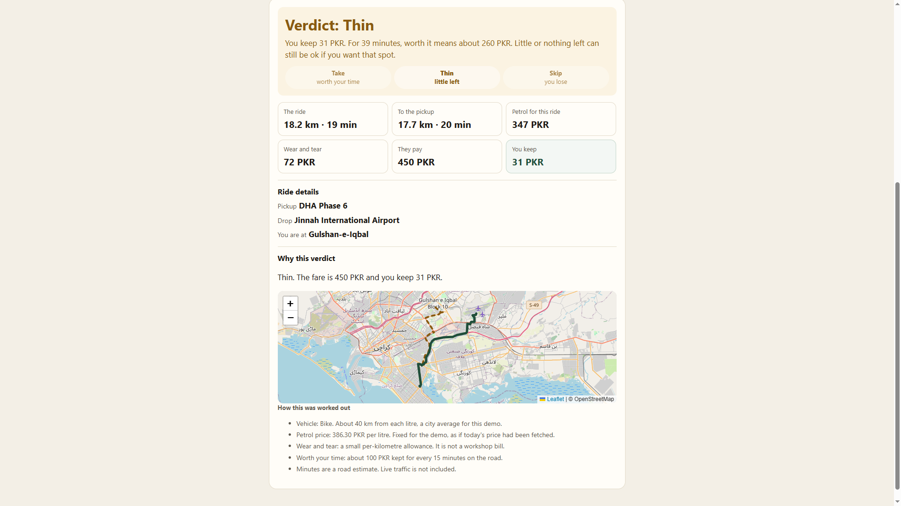

---
title: RideWorth: a Karachi driver checks the fare before tapping accept
published: false
tags: devchallenge, hf26challenge, ai, gemma

*This is a submission for the [Hacktoberfest Open-Source AI Challenge Week 2: Side Hustle](https://dev.to/challenges/hacktoberfest-week2-2026-10-12)*

## What I Built

I was walking in my neighborhood on a random afternoon in my city of Karachi when I saw a rickshaw driver sitting still, phone in his hand, Bykea (a local ride-hailing service app) ringing with offers. He looked unsure which one to take. That pause is the product.

In Karachi, ride-hailing is how a lot of people work now. Yango, Bykea, inDrive, and before them Uber and Careem. Some drivers do it all day, as their bread and butter. Some turn the app on between a job and home. Plenty of them are not sitting there to do arithmetic. Some cannot read a fare breakdown easily. Others can, and still do not want to estimate petrol, the empty ride to the pickup, and the minutes, on every ping.

**RideWorth** is a check for that person. They paste the offer, or say it, and get a verdict before they tap accept: **Take**, **Thin**, or **Skip**.

- **Take** means the money left is enough for the time they will spend.
- **Thin** means little or nothing is left, which can still be worth it if they want that spot.
- **Skip** means the petrol and wear cost more than the fare.

The person who would pay is the driver holding the phone. I want the price kept low on purpose. These are often people who barely save, and the point is to help them, not to take a cut of a hard day. A wrong accept is already a fee. It is paid in petrol. RideWorth only makes sense if it costs less than that mistake. The audience is large, so a small subscription can still be a real business, even when each person pays very little. A few checks free, so someone can see it work on a real offer, then a small fee after that. Later, if drivers are actually using it, the bigger step is a conversation with Yango, Bykea, or inDrive: an integration, or a buyout. The driver should not be the one funding a high price.

This demo is Karachi only. That is where I saw the problem.

## Demo





Offers worth trying:

- I'm in Gulshan-e-Iqbal. Pickup from DHA Phase 6, drop at Jinnah International Airport. Fare 450.
- Pickup Safari Park, drop Jail Chowrangi, fare 280.
- DHA Phase 8, Creek Club, to FTC on Shahrah-e-Faisal, 370.
- NIPA, Samama, Bottle Gali, Rosati Bistro. Say them the way a driver would.

To run it:

```
copy .env.example .env
```

Put a Google AI Studio key in `GEMINI_API_KEY`, then `npm start`, and open [http://localhost:3000](http://localhost:3000)

## Code


The repo is the demo: one Node process, no database, and the money rules in plain code with tests.

## How I Built It

Gemma 4 (`gemma-4-26b-a4b-it`) is the open-weight model, served through the Gemini API. It does the part a calculator cannot do. A driver writes in English or Roman Urdu, often in a hurry, and Gemma reads that into a pickup, a drop, a fare, and where they are now. It also rewrites messy place names into something a Karachi map will find. "Jail chorangi" becomes Jail Chowrangi. A second Gemma reply writes a short English note on why the verdict came out that way, including when a place is too broad to trust.

The rupees are not the model's job. Nominatim searches the place inside Karachi. OSRM then gives the real driving distance and the minutes, both for the ride with the passenger and for the unpaid ride to the pickup when we know where the driver is. Those are road kilometres, not a straight line across the map. The app applies a city fuel average for the vehicle they picked (bike, rickshaw, Suzuki Alto, Suzuki Mehran, Honda City, Toyota Corolla), petrol at 386.30 PKR per litre, and a small wear-and-tear allowance per kilometre. **You keep** is the fare minus petrol minus wear.

The screen leads with Take, Thin, or Skip, then the numbers in an order a driver can follow: the ride, the ride to the pickup, petrol for this ride, wear and tear, what they pay, and what they keep. Petrol for this ride is kept separate from the pump price, which sits in the small print, so the two are not confused. Wear and tear is shown so the leftover is not a mysterious gap. It is a small allowance, not a workshop bill. Ride details are the words we actually used. The map, drawn with Leaflet on OpenStreetMap, shows a dashed line to the pickup and a solid line with the passenger, so they can see the places landed in the city.

Take, Thin, or Skip follow from that leftover and the minutes. About 100 PKR kept for every 15 minutes is the line for "worth your time." A 15-minute ride needs about 100 PKR left. The same ride after 15 minutes getting to the pickup needs about 200, because the driver was out for half an hour. Zero left is Thin, not a loss. A loss is Skip. The minutes are a road estimate. Live traffic is not in them, and the small print says so.

This pass is the pitch. The shape I want next is a phone app. Fuel price fetched for the day, not a fixed demo number. A suggested fare when the offer is thin. Urdu spoken back, not only English on the screen. Traffic, when it is worth trusting. And the same open weights running on the phone, so the offer never has to leave the device. That last one is the private version of this idea. The demo sends the offer text to Google so Gemma can read it. A driver should not have to accept that forever.

The other conversation, once people are using it, is with the apps already on their phone.

## Why Does Open Innovation Matter?

Any decent model can read an offer. That is not the reason this one is open.

The reason is the price of the product. I want a few free checks, then a small fee, for people who barely save. A closed model billed on every ping fights that. The driver will not pay a vendor's rate each time the phone rings, and I do not want a cut that eats the help. Open weights are how the check can stay cheap enough to exist. This hosted demo is the stepping stone, not the destination. Gemma reads the offer through Google's API so someone can try it on an ordinary laptop, and the offer text does leave the machine. The weights are not stuck on that host or that price list. If the host retires the model or changes the bill, I can keep a copy. I can pin the version I test, instead of having an update quietly change how a fare is read. The same model can later run on the phone, which is the private version: the offer stays on the device, and the cost of a check falls toward nothing.

The money stays outside the model for the same reason. Distance, petrol, wear, and the verdict are calculated here. Swapping Gemma, or later teaching a copy Karachi spellings and Roman Urdu, does not move the arithmetic. I have not fine-tuned it yet. The model cannot invent a fare. A closed API would own both the reading and the bill. Open weights let me keep the reading and refuse the bill.

## Prize Categories

- Best Use of Gemma

